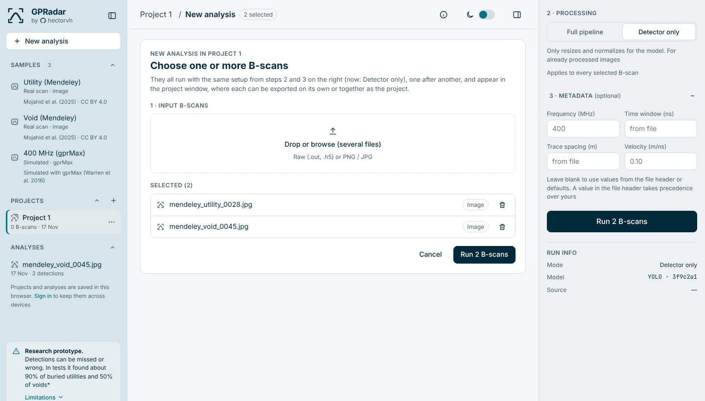

<p align="center">
  
</p>

# GPRadar-UI

[](https://github.com/hectorvh/GPRadar-UI/blob/main/LICENSE)
[](https://gpradar.hectorvh.com)
[](https://react.dev/)
[](https://vite.dev/)
[](https://www.typescriptlang.org/)
[](https://nodejs.org/)
[](https://github.com/hectorvh/GPRadar-UI/commits/main)
[](https://doi.org/10.5281/zenodo.24339830)

**Live demo: <https://gpradar.hectorvh.com>**

Web interface for **GPRadar**, a prototype that detects hyperbolas (buried
pipes, cables, voids) in ground-penetrating radar B-scans with a YOLO model.



Pick a bundled sample or upload a B-scan (PNG/JPG) or a gprMax output file
(`.out`, `.h5`). The app sends it to
[GPRadar-API](https://github.com/hectorvh/GPRadar-API), then shows the
radargram with detection boxes, axes and a detections table. You can filter
detections by confidence and export them as CSV or as an annotated PNG.

## Using the interface

- **Home screen.** Shown when no sample or project is open, and when you
  click the logo. It explains the tool, shows a figure from the GPRadar
  repository (`figures/demo/mendeley_detections.png`: hand labels and model
  detections on real scans, saved as `public/home-detections.png`), offers
  the bundled samples as cards (a click runs one) and an upload button (or
  drop a file anywhere on the card), and lists the three steps.
- **Side menu (left).** The header shows the logo, *GPRadar* and *by
  hectorvh* (GitHub). *New analysis* goes to Home for a single B-scan. Then
  three sections you can open or hide: *Samples* (Utility (Mendeley), Void
  (Mendeley), 400 MHz (gprMax); a click runs one), *Projects* (with a **+**
  in its heading to create a project) and *Analyses*. The disclaimer says in
  plain numbers how often the detector finds targets (about 90 % of
  utilities and 50 % of voids on held-out real scans) with a \* that points
  to the details under *Limitations*. At the bottom: a small *Sign in*
  button and a ⚙ *Settings* button. The open/closed state of the sections is
  remembered.
- **Analyses and projects.** An *analysis* is one B-scan run: its name,
  input, mode, threshold and result. A *project* is a named collection of
  analyses. Both are saved in this browser (IndexedDB) until accounts exist.
  - A B-scan run from Home becomes an independent analysis, listed under
    *Analyses*. Opening one shows its result again without calling the API
    (a bundled sample can be run again; an uploaded file must be uploaded
    again). At most 200 analyses are kept; the oldest unpinned independent
    ones are removed first, never those in a project.
  - The project window lists the project's analyses with *New analysis* and
    *Download project (.zip)* at the top. *New analysis* opens a window
    where you pick one or more B-scans (several files at once; samples are
    not offered inside projects); they all run with the **same setup** from the right panel
    (steps 2 and 3: one processing mode and the same metadata), one after
    another, and
    appear in the project window. The queue starts by itself; *Pause* /
    *Resume* and *Retry failed* are there when needed. On a rate limit (429)
    it waits a minute and retries once. Queued files are kept in memory
    only.
  - Downloads: each analysis as CSV or annotated PNG, or the whole project
    as a zip (a folder per analysis with its CSV and annotated PNG, plus
    `summary.csv`).
  - The top bar shows *Project name / analysis name* for an analysis inside
    a project (click the project name to go back), like the project / chat
    title on claude.ai; the name is not repeated elsewhere.
  - Every project and analysis has an options menu: *…* on hover in the
    side menu or the project table, and *⌄* next to the name in the top bar.
    Projects: Pin (P), Rename (R), Download project (.zip), Share (needs an
    account), Archive (A), Delete (D; optionally with its analyses, otherwise
    they become independent). Analyses: Pin, Rename, *Move to project…* (M:
    another project, a new project, or no project), *Make independent*,
    Export CSV / annotated PNG, Share, Archive, Delete.
- **Names.** Click the title in the top bar (*New analysis* at first, or the
  project's name in the project window) to rename it; Enter saves, Escape cancels, an empty name goes back to the
  default. The name is also used for the CSV and PNG export file names.
- **Steps 1 to 3.** *1 · Input B-Scan* (drop or browse: raw `.out` / `.h5`,
  or PNG / JPG) sits in the main column: on Home, above the viewer once a
  file or sample is chosen, and in a project's New analysis (several files).
  The right panel holds only *2 · Processing* (*Full pipeline* for raw
  records, *Detector only* for processed images) and *3 · Metadata*
  (frequency, time window, trace spacing, velocity), the Run button and Run
  info. The right panel is shown only while setting up or running an
  analysis: it is hidden in the project window and once a result is on
  screen (its toggle in the top bar goes too).
- **Viewer.** Raw / Processed tabs, a confidence slider, and axes in time,
  distance and approximate depth when the metadata allows. Click a box or a
  table row to highlight the same detection in both.
- **About (ⓘ in the top bar).** Licences, source code links (MIT UI,
  AGPL-3.0 API), the model and the data credits. This replaces the old page
  footer; the AGPL source link must stay in it.
- **Settings (⚙).** Saved in this browser: *View samples* (show or hide the
  samples in the side menu and on the first screen), and which processing
  modes are offered, *Full pipeline* and *Detector only* (at least one stays
  on; with one on, every run uses it and the input panel shows it as a
  label). A GitHub-style *Danger Zone* holds *Delete account*: disabled for
  guests; for a signed-in user it asks to type “delete my account” first.
  `deleteAccount()` in `src/lib/auth.ts` is a placeholder; it needs a
  server-side function (it must delete the auth user and the saved
  analyses), never the service key in the browser.
- **Sign in.** Opens a dialog with *Log in*, *Sign up* (email and password,
  or Google) and *Continue as guest*. **Accounts are not implemented yet:**
  the forms check their input and then say that accounts are not available.
  `src/lib/auth.ts` holds the functions to connect to a provider (Supabase
  Auth or Firebase Auth both do email + password and Google); set
  `AUTH_AVAILABLE` and replace the three functions when the backend exists.
  The CSP in `build/csp.ts` will then need the provider's origin in
  `connect-src`.
- **Shortcuts.** <kbd>Ctrl</kbd>/<kbd>⌘</kbd> + <kbd>Enter</kbd> runs
  detection (no label on the button; the tooltip mentions it). Both side panels can be hidden and resized (drag the edge, or
  focus it and use the arrow keys); the layout is remembered in the browser.
- **Phones.** One column: top bar, results, then the input panel. The side
  menu starts closed and the page scrolls to the result when a run finishes.
- **Cold start.** The API runs on free hosting and sleeps when idle. The
  first request can take up to about a minute; a banner says so and the run
  starts by itself when the server is up.

It is a static Vite + React + TypeScript app with no backend of its own.

> **Prototype.** Detections can be missed or wrong, and depths are
> approximate. Do not rely on them for excavation or engineering decisions.

## How to run

You need **Node.js 22** and a running **GPRadar-API**.

1. **Start the API** on `http://localhost:8000` by following the
   [GPRadar-API README](https://github.com/hectorvh/GPRadar-API). By default
   the API accepts requests from `http://localhost:5173`.

2. **Start the interface:**

   ```sh
   npm install
   cp .env.example .env.local   # sets VITE_API_URL=http://localhost:8000
   npm run dev
   ```

3. **Open** <http://localhost:5173> and click a sample in the left menu.

If the API runs somewhere else, change `VITE_API_URL` in `.env.local`. This
value ends up in the public JavaScript, so never put secrets in it.

## Other commands

| Command | What it does |
| --- | --- |
| `npm test` | Run the unit tests |
| `npm run lint` | Check the code with ESLint |
| `npm run build` | Build the static site into `dist/` |
| `npm run preview` | Serve the built site on <http://localhost:4173> |

To build for a deployed API, set the URL at build time:

```sh
VITE_API_URL=https://your-api.example.org npm run build
```

## Deploying to Netlify

`netlify.toml` already holds the build settings. In the Netlify site
settings, set `VITE_API_URL` to the API's public URL (for example the
Render service URL). On the API side, add every address the site is served
from to `ALLOWED_ORIGINS`, comma-separated, for example
`https://gpradar.hectorvh.com,https://<site>.netlify.app`. The build also
writes the Content-Security-Policy to `dist/_headers`, so after changing
`VITE_API_URL` trigger a new deploy rather than only editing the variable.

The live site uses the custom domain `gpradar.hectorvh.com` (a subdomain of
hectorvh.com pointed at Netlify). The canonical URL and the social-preview
tags in `index.html` use that address; change them if the domain changes.

## Logo and brand assets

The logo (option E, *Detection*) is a radar hyperbola inside viewfinder
brackets: what the detector does. It has no background and one colour that
follows the theme: dark `#00293A` in light mode, light `#C4FFFB` in dark
mode (`--logo-mark` in `tokens.css`). The favicon does the same with the
browser's colour scheme. Home-screen icons need an opaque background, so
they use the page colour `#F5F7F8` behind the dark mark; the link preview
shows the light mark on the dark page colour.

Mini icons in `icons.tsx` reuse the logo's lines: `SampleIcon` (a scan in a
frame; dashed hyperbola for simulated samples), `AnalysisIcon` (the logo's
brackets and hyperbola with the detected apex) and `ProjectIcon` (a frame
behind the logo mark: several analyses).

| File | Use |
| --- | --- |
| `public/favicon.svg` | Browser tab icon and the README logo |
| `src/components/icons.tsx` → `LogoIcon` | The same drawing inside the app (side menu, top bar) |
| `public/apple-touch-icon.png`, `public/icon-192.png`, `public/icon-512.png` | Home-screen icons (page-colour background), listed in `public/site.webmanifest` |
| `public/og-image.png` | 1200 × 630 link preview (LinkedIn, Slack, etc.) |
| `design/brand/` | Editable sources: `logo-mark.svg` (light), `logo-mark-dark.svg`, `icon-full-bleed.svg`, `og-image.html`; `logo-options.html` keeps the eight options that were compared (E was chosen) |

To regenerate
the PNGs, open the SVG or `og-image.html` in a browser at the target size
and take a screenshot (or use any SVG-to-PNG tool); keep the file names.

## Project layout

```
src/
  App.tsx              page state: source, mode, run, selection, exports
  components/          EmptyState (home), LeftNav + LibraryNav (projects, analyses),
                       ProjectView (project window), ItemMenu, MoveDialog, TopBar
                       (+ EditableTitle), InputPanel, Viewer (+ Axes, BoxOverlay),
                       DetectionsTable, StatusBanner, Dialog, InfoDialog,
                       AuthDialog, SettingsDialog, …
  hooks/               useBackend (wake-up + /health), useRun, useBatch (project
                       queue), useLibrary (IndexedDB), useSettings, usePanels, useTheme
  lib/                 API client, validation, CSV/PNG/zip export, library
                       (types and rules), store (IndexedDB), formatting,
                       auth.ts (placeholder until accounts exist) (+ tests)
  styles/              tokens.css (colours), base.css (components)
build/csp.ts           writes dist/_headers with the Content-Security-Policy
design/                the original mockup and the brand sources
```

## Related projects

- [GPRadar](https://github.com/hectorvh/GPRadar): research code, data and training
- [GPRadar-API](https://github.com/hectorvh/GPRadar-API): the detector service (AGPL-3.0)
- [gpradar-hyperbola-yolo](https://huggingface.co/hectorvh/gpradar-hyperbola-yolo): the model on Hugging Face

## Licence

MIT. See [LICENSE](LICENSE). Real-scan samples come from Mojahid et al. (2025),
Mendeley Data, [DOI 10.17632/ww7fd9t325.1](https://doi.org/10.17632/ww7fd9t325.1)
(CC BY 4.0).
