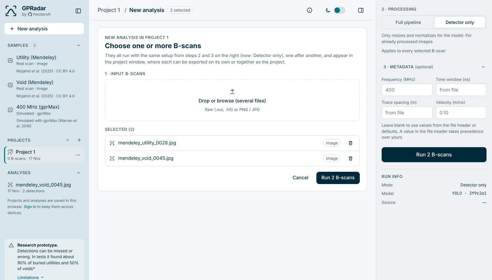

## GPRadar-UI 1.2.0 (2026-11-20)

GPRadar-UI 1.2.0 adds projects and analyses. Every B-scan run is saved as
an analysis, and a project groups several analyses, so you can run a set of
B-scans with one setup and download them together. The release also brings
the new logo, a new home screen and a Settings dialog. Live at
<https://gpradar.hectorvh.com>.

### Highlights

- **Projects and analyses.** A run from Home becomes an analysis under
  *Analyses*; open it again without calling the API. **+** next to
  *Projects* creates a project. The project window lists its analyses.
  *New analysis* there takes several B-scans at once and runs them one
  after another with the same mode and metadata. *Download project (.zip)*
  gives a folder per analysis (CSV and annotated PNG) plus `summary.csv`.
  Options menus (… and ⌄) pin, rename, move, archive and delete.
- **Logo E and mini icons.** A hyperbola inside viewfinder brackets, with
  no background: dark in light mode, light in dark mode. It is used for the
  favicon, home-screen icons and link previews. Small icons for samples,
  analyses and projects reuse its lines.
- **Home screen.** A short explanation, a figure from the GPRadar
  repository (hand labels and model detections on real scans), sample cards
  that run on click, upload with drag and drop, and a three-step guide.
- **Settings.** *View samples* shows or hides the bundled samples. Choose
  which processing modes are offered (at least one stays on). A Danger Zone
  holds *Delete account*.
- **Step 1 in the main column.** *1 · Input B-Scan* sits above the viewer
  and in a project's New analysis. The right panel keeps *2 · Processing*
  and *3 · Metadata*, and is hidden in the project window and once a result
  is shown.

The full list is in [CHANGELOG.md](https://github.com/hectorvh/GPRadar-UI/blob/v1.2.0/CHANGELOG.md).

### Known limits

- Projects and analyses are stored in this browser only (IndexedDB). They
  do not follow you to another browser or device, and clearing site data
  removes them.
- Queued B-scans are kept in memory: those not finished are lost on reload.
- Accounts and *Share* are not available yet. *Sign in* checks the form
  and then says so.
- *Delete account* needs the backend that comes with accounts; until then
  it is disabled for guests.

### Compatibility

- Works with GPRadar-API 1.1.0 (contract `api_version` 1.1). No API change.
- GPRadar-API 1.1.1 brings the new sample names: Utility (Mendeley),
  Void (Mendeley), 400 MHz (gprMax). With 1.1.0 the samples keep their
  earlier names.
